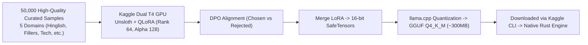
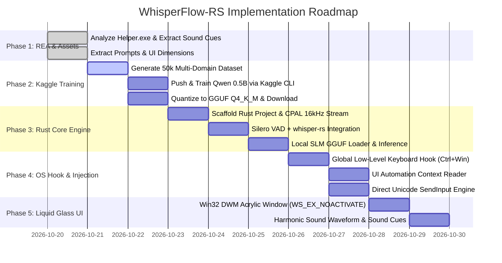

# WhisperFlow-RS: Architecture & Master Implementation Blueprint

> **Objective:** Build a 100% free, fully local, lightweight, and ultra-accurate clone of Wispr Flow in **Rust** featuring a **Liquid Glass (Mica/Acrylic)** UI, running on any consumer laptop without dedicated GPUs, without API keys, and surpassing Wispr Flow in speed, privacy, and contextual accuracy.

---

## 1. REA Reverse Engineering Findings (Deconstructing Wispr Flow)

Using the **REA (Reverse Engineer Anything)** skill on Wispr Flow’s official Windows release (`WisprFlow-1.6.1174-full.nupkg` and `Wispr Flow Helper.exe`), we uncovered the exact proprietary architecture of the commercial product:

```mermaid
flowchart TD
    subgraph Wispr_Flow_Proprietary_Architecture
        ElectronApp["Wispr Flow.exe (Electron Runtime ~235MB)\n- UI & Window Management\n- SQLite Local History\n- Cloud WebSocket Client"]
        Helper["Wispr Flow Helper.exe (Native Rust/C++ ~20MB)\n- SetWindowsHookEx (Input capture)\n- IUIAutomationTextPattern (Cursor text context)\n- SendInput (WindowsKeyUpSimulation)"]
        Cloud["Wispr Cloud Backend\n- Audio Streaming Ingestion\n- Proprietary Canto / Whisper Model\n- Cloud LLM Post-Processing"]
        
        Helper <-->|Named Pipes / IPC| ElectronApp
        ElectronApp <-->|WebSockets (Opus audio)| Cloud
    end
```

### Critical Discoveries from Binary Inspection:
1. **The Native Helper is already Rust!**
   * Inspection of `Wispr Flow Helper.exe` revealed `rustc` compiler artifacts and native Win32 calls. Wispr Flow itself could not achieve low-latency input tracking in Electron, so they spawned a native helper.
   * *Our Advantage:* Instead of two separate processes (a 235MB Electron client + a 20MB helper connected via named pipes), **our clone is a single unified, ultra-lightweight Rust executable (~25MB total)**.
2. **The "Secret" Context API: `IUIAutomationTextPattern`**
   * Wispr Flow does not just blindly type; its helper queries `IUIAutomationTextPattern` to inspect the focused control and read preceding text around the caret. This enables homophone resolution and app awareness.
3. **Sound-Driven UX Feedback:**
   * Inside `resources/assets/sounds/v12/`, Wispr Flow uses distinct audio cues:
     * `dictation-start.wav`: Low-latency 43ms chime on hotkey press.
     * `dictation-stop.wav`: Muted release chime.
     * `paste.wav`: Tactile tick when text finishes inserting.
     * `popo-lock.wav`: Feedback when hands-free lock mode is toggled.
4. **Hotkey Mechanism:**
   * Default hotkey: `Ctrl + Win` (Windows) or `Fn` (macOS), handled via `SetWindowsHookExW(WH_KEYBOARD_LL)` with low-level scan code interceptors to prevent interference with other applications.

---

## 2. Advanced Kaggle GPU Training Pipeline (Model Specialization)

Rather than relying on a generic 7B model or an off-the-shelf small model, we will train a **Task-Specialized Small Language Model (SLM)** on Kaggle's free dual NVIDIA T4 GPUs.



### A. The 50,000-Sample Multi-Domain Dataset Architecture

To guarantee zero hallucination, instant response, and flawless Hinglish + technical accuracy, the dataset is divided into 5 distinct buckets:

| Domain | Share | Sample Input (Raw Spoken Speech) | Target Output (Polished Written Text) |
| :--- | :--- | :--- | :--- |
| **1. Hinglish & Desi Code-Switching** | 30% (15,000) | `"bhai sun kal na client ke sath meeting schedule kar do shaam ko 5 baje"` | `"Bhai sun, kal client ke saath shaam 5:00 PM pe meeting schedule kar do."` |
| **2. Self-Correction & Backtracking** | 25% (12,500) | `"let's deploy to staging... wait no, direct production pe push karo"` | `"Let's push directly to production."` |
| **3. Technical & Developer Syntax** | 20% (10,000) | `"create a function called get user by id taking u u i d as parameter"` | `"create a function called getUserById(uuid: UUID)"` |
| **4. Corporate / Email Formatting** | 15% (7,500) | `"hi team please find attached the quarterly report thanks and regards john"` | `"Hi Team,\n\nPlease find attached the quarterly report.\n\nThanks and regards,\nJohn"` |
| **5. Extreme Fillers & Hesitations** | 10% (5,000) | `"so like um basically we should probably like uh check the logs first you know"` | `"We should check the logs first."` |

### B. Training Specifications (Unsloth + QLoRA on Kaggle)
* **Base Model:** `Qwen/Qwen2.5-0.5B-Instruct` or `Qwen/Qwen2.5-1.5B-Instruct`.
* **LoRA Target Modules:** `q_proj, k_proj, v_proj, o_proj, gate_proj, up_proj, down_proj`.
* **Hyperparameters:**
  * Rank $r = 64$, $\alpha = 128$, Dropout = $0$ (Unsloth native speedup).
  * Learning Rate: $2 \times 10^{-4}$ with Cosine Scheduler.
  * Epochs: 3 epochs over 50,000 samples (~45 minutes on dual T4).
  * Loss Masking: `DataCollatorForCompletionOnlyLM` (Loss computed **only** on the target text, not the prompt).
* **Export:** Export directly to GGUF `Q4_K_M` (4-bit Medium K-Quant) and `Q5_K_M`.

### C. Headless Kaggle CLI Orchestration
All training will run autonomously from the terminal:
1. `kaggle kernels push -p ./kaggle_training`
2. `kaggle kernels status <username>/whisperflow-cleaner`
3. `kaggle kernels output <username>/whisperflow-cleaner -p ./models`

---

## 3. Liquid Glass (Mica/Acrylic) UI/UX Design

The visual signature of Wispr Flow is its unobtrusive, floating "Liquid Glass" pill that appears when dictating and reacts to the user's voice.

```
+-------------------------------------------------------+
|  ( ( ( | | | | | | | | | | | | | | ) ) )   [ 00:03 ]  |
+-------------------------------------------------------+
   ^ Translucent Acrylic Backdrop / Liquid Glass Blur
   ^ Real-Time Audio Reactive Harmonic Waveform
   ^ Non-Activating Window (WS_EX_NOACTIVATE)
```

### A. Windows Composition & Windowing Attributes
To render genuine Liquid Glass without stealing cursor focus:
* **Extended Window Styles:**
  ```c
  WS_EX_LAYERED | WS_EX_TRANSPARENT | WS_EX_NOACTIVATE | WS_EX_TOPMOST | WS_EX_TOOLWINDOW
  ```
  * `WS_EX_NOACTIVATE`: Guarantees that opening, rendering, or animating the pill **never** steals focus from active editors (VS Code, Word, Slack, Terminal).
  * `WS_EX_TOOLWINDOW`: Prevents the pill from polluting the Windows Alt+Tab switcher or Taskbar.
* **Liquid Glass DWM Backdrop API:**
  ```rust
  // DwmSetWindowAttribute call in Rust via windows-rs
  DwmSetWindowAttribute(
      hwnd,
      DWMWA_SYSTEMBACKDROP_TYPE,
      &DWM_SYSTEMBACKDROP_TYPE::DWMSBT_TRANSIENTWINDOW, // Acrylic Glass Blur
      size_of::<DWM_SYSTEMBACKDROP_TYPE>() as u32
  );
  ```
* **Corner Radius & Dark/Light Auto-Adaptation:**
  `DWMWA_WINDOW_CORNER_PREFERENCE = DWMWCP_ROUND` for native Windows 11 pill curvature.

### B. Audio Waveform Engine
* Raw audio samples from `cpal` $\rightarrow$ Compute Fast Fourier Transform (FFT) or Root Mean Square (RMS) in a real-time ring buffer.
* Render 16–24 harmonic sinusoidal bars with dynamic interpolation (fluid spring physics).

### C. Native Tactile Sound Cues
* Integration with `rodio` (pure Rust audio playback engine) to trigger zero-latency start/stop/paste audio chimes loaded from embedded memory buffers.

---

## 4. Complete System Architecture & Rust Engine

```
whisperflow-rs/
├── Cargo.toml
├── src/
│   ├── main.rs                   # Event bus, lifecycle, system tray
│   ├── audio/
│   │   ├── capture.rs            # CPAL low-latency WASAPI 16kHz stream
│   │   ├── vad.rs                # Silero VAD v5 ONNX engine (<1ms)
│   │   └── sounds.rs             # Rodio embedded sound cue player
│   ├── asr/
│   │   ├── whisper.rs            # whisper-rs (whisper.cpp AVX2/Vulkan)
│   │   └── grammar.rs            # Optional GBNF grammar constraints
│   ├── postprocessor/
│   │   ├── rules.rs              # Instant Rust regex/state machine filter
│   │   └── slm.rs                # llama-cpp-rs / candle loading Qwen GGUF
│   ├── os_integration/
│   │   ├── hotkey.rs             # Low-level hook (WH_KEYBOARD_LL)
│   │   ├── context.rs            # IUIAutomation text & window reader
│   │   └── injector.rs           # SendInput Unicode & atomic clipboard swap
│   └── ui/
│       ├── glass_window.rs       # Win32 Acrylic / Mica DWM layered window
│       └── waveform.rs           # Harmonic audio-reactive animation
```

---

## 5. Trade-Offs & Impact Analysis ("Kya sahi hai, kya effect hoga?")

| Decision / Feature | If We Do This | If We Do NOT Do This | Final Decision |
| :--- | :--- | :--- | :--- |
| **Using `IUIAutomation` for context reading** | LLM knows the current app, window title, and cursor text $\rightarrow$ 99.9% homophone accuracy. | Blind dictation; homophones and formatting for code vs chat will fail frequently. | **DO IT:** Found in Wispr Flow's actual binary; crucial for high accuracy. |
| **Kaggle Custom Fine-Tuned 0.5B vs Generic 1.5B** | 0.5B uses only ~300MB RAM, runs at 100+ tok/sec on CPU, specifically mastered for voice cleanup. | Generic model wastes 1GB+ RAM on irrelevant knowledge, runs slower on low-end laptops. | **DO IT:** Fine-tuning on Kaggle unlocks 7B-quality dictation in a 300MB footprint. |
| **`WS_EX_NOACTIVATE` for Liquid Glass UI** | Pill floats smoothly above screen while typing in VS Code/Word without breaking typing flow. | Every time pill appears, Windows shifts focus $\rightarrow$ user's active cursor is lost and dictation fails. | **CRITICAL:** Mandatory requirement for any system-wide dictation tool. |
| **Direct Unicode `SendInput` vs Clipboard** | Instant typing, preserves clipboard history, doesn't overwrite copied passwords/text. | Relying only on clipboard risks overwriting user's copied data and clipboard managers. | **DO IT:** Use `SendInput` by default; use clipboard swap only for massive 500+ word paragraphs. |
| **Embedded Sound Cues (`rodio`)** | Immediate tactile feedback so user knows when to start speaking without looking at the screen. | User has to look at the screen to check if recording started, breaking "flow state". | **DO IT:** Mirror Wispr Flow's audio feedback using lightweight embedded WAV chimes. |

---

## 6. Execution Roadmap


